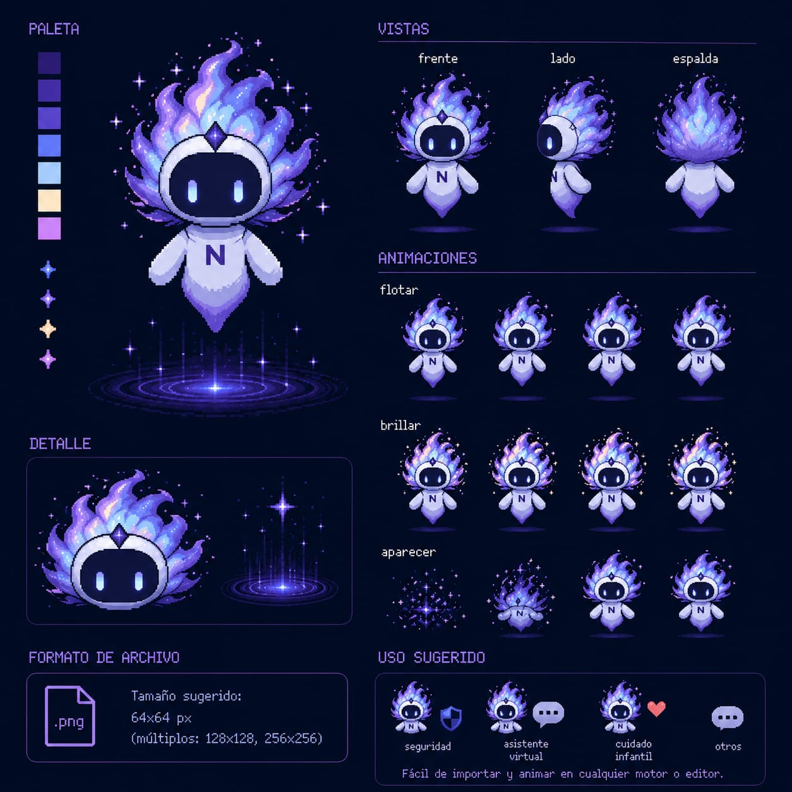
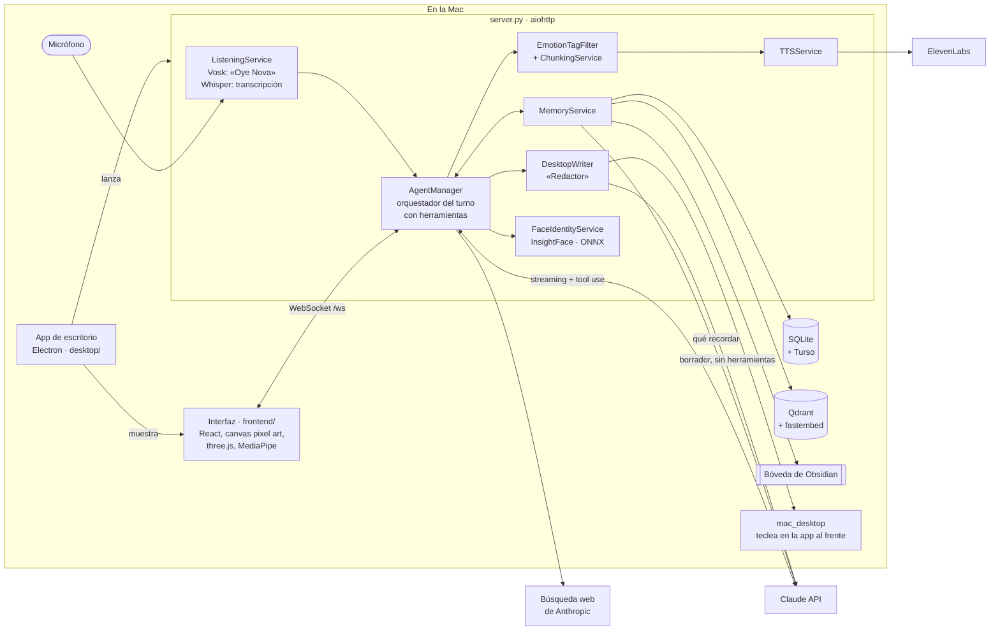

# NOVA

**Compañera de IA personal que vive en el escritorio: la llamas por su nombre, platica con voz en español de México, siente emociones que se ven en su cuerpo y recuerda lo que le cuentas.**

[](https://github.com/CarlosIsaelRamirezGonzalez/NOVA/actions/workflows/ci.yml)


<p align="center">
  
</p>

<!-- TODO: GIF principal de 10–15 s (ver docs/capturas.md): decir "Oye Nova", que salga del portal y responda. -->

## Qué hace

- **Voz en español de México.** Se activa con "Nova" u "Oye Nova", transcribe dentro de la Mac y responde con voz de ElevenLabs, frase por frase, para empezar a hablar en cuanto puede.
- **Emociones en su cuerpo.** El modelo marca mezclas de emociones (por ejemplo, triste y preocupada a la vez) y el personaje en pixel art las muestra al momento; reacciona a gestos de la mano.
- **Memoria persistente.** Decide qué vale la pena recordar de cada plática y lo guarda en SQLite (sincronizado con Turso). Busca recuerdos por significado con Qdrant y los exporta a una bóveda de Obsidian. Olvida cuando se lo pides.
- **Visión por cámara bajo petición.** La cámara está apagada por defecto; solo toma una foto cuando le pides que mire. Puede aprender tu cara y distinguirte en las fotos.
- **Búsqueda en internet.** Decide con una herramienta cuándo buscar datos actuales en lugar de responder de memoria.
- **Escritura asistida en otras apps.** Le pides "termina este mensaje" y teclea un borrador en la app que tienes al frente. Nunca envía.
- **App de escritorio.** Flota sobre las demás ventanas, aparece al llamarla, se mueve, baila, se marea si la sacudes y se despide cuando terminas.
- **Cuentas claras.** Una vista muestra lo que gasta en modelo y voz.

<!-- TODO: capturas de la vista de memoria ("cerebro" en 3D), de gastos y de la app en el escritorio (ver docs/capturas.md). -->

## Arquitectura

Todo corre en la Mac salvo tres servicios externos: Claude (modelo), su búsqueda web y ElevenLabs (voz).



**Cómo es un turno:** `AgentManager` arma el contexto (recuerdos relevantes, ánimo, hora, foto si se pidió) y llama a Claude en streaming. El modelo puede usar herramientas para buscar, mirar, olvidar, escribir, moverse o aprender tu cara. Mientras llegan los tokens, `EmotionTagFilter` separa las emociones del texto y `ChunkingService` corta frases completas para que la voz empiece antes. Al terminar, `MemoryService` decide en segundo plano qué guardar.

## Stack

| Parte | Tecnología |
|---|---|
| Servidor | Python 3.14, aiohttp, WebSocket, Pydantic |
| Modelo | Claude Haiku (API de Anthropic) con tool use y búsqueda web |
| Voz | Vosk (palabra de activación) y Whisper (whisper.cpp) en local; ElevenLabs para hablar |
| Memoria | SQLite con Turso, Qdrant, fastembed (`paraphrase-multilingual-MiniLM-L12-v2`), Obsidian |
| Visión | MediaPipe (manos y cara, en el navegador), InsightFace `buffalo_sc` con ONNX Runtime |
| Interfaz | React 19, TypeScript, Vite, Tailwind, canvas en pixel art, three.js |
| Escritorio | Electron, APIs de macOS (CoreGraphics, Accesibilidad) |
| Calidad | pytest, ruff, oxlint y GitHub Actions |

## Privacidad y seguridad

- **La detección de manos y cara corre en el equipo** (MediaPipe en el navegador). No se manda video a ninguna API.
- **El audio no sale de la Mac.** La palabra de activación y la transcripción son locales; a internet solo viaja el texto.
- **La cámara está apagada por defecto.** Solo se toma una foto cuando lo pides, y esa foto sí se envía a Claude para describirla. Hay un límite diario de fotos.
- **La huella de tu cara es local.** Se calcula con InsightFace dentro de la Mac; las caras de otras personas no se guardan. Se borra con "olvida mi cara".
- **El Redactor está aislado.** Es una llamada aparte al modelo, sin herramientas ni memoria: lo que diga un mensaje en pantalla solo puede cambiar el borrador, que tú revisas.
- **Nunca envía.** Los saltos de línea y caracteres de control se quitan en el código antes de teclear, así que no puede presionar Enter. No escribe en terminales, gestores de contraseñas ni ajustes del sistema, y se detiene si mueves el mouse o presionas Esc.
- **Tus datos no van al repositorio:** `.env` y `data/` están en `.gitignore`.

## Inicio rápido

Requisitos: macOS, Python 3.14, Node 22 o más reciente y claves de Anthropic y ElevenLabs.

```bash
python3 -m venv .venv && source .venv/bin/activate
pip install -r requirements.txt
npm --prefix frontend install
```

Crea un archivo `.env` con `ANTHROPIC_API_KEY` y `ELEVENLABS_API_KEY`. Agrega `TURSO_DATABASE_URL` y `TURSO_AUTH_TOKEN` si quieres sincronizar la memoria.

**En el navegador:** `./start.sh` y abre http://localhost:5173.

**App de escritorio:**

1. Coloca en `data/models/` el modelo de Vosk `vosk-model-small-es-0.42` y, en `data/models/whisper/`, el de Whisper `ggml-base.bin`.
2. `npm --prefix desktop install` (si tu npm bloquea scripts: `node desktop/node_modules/electron/install.js`).
3. `npm --prefix frontend run build` y luego `npm --prefix desktop start`.
4. Para que escriba en otras apps, concede a Electron los permisos de Accesibilidad y Grabación de pantalla.
5. Para que te reconozca: `.venv/bin/python scripts/download_face_model.py` (unos 15 MB) y dile "Nova, apréndete mi cara" con buena luz.

Órdenes que entiende en el escritorio: "muévete", "quédate quieta", "pasea", "da una vuelta", "voltéate", "baila", "desaparece".

## Desarrollo

```bash
pip install -r requirements-dev.txt
ruff check . && pytest
npm --prefix frontend run lint && npm --prefix frontend run build
```

Las pruebas cubren la lógica que no necesita red, micrófono ni macOS: la separación de emociones y etiquetas, el corte de frases para la voz y los nombres de la bóveda de Obsidian.

## Historia del proyecto

- **[Bitácora de desarrollo](docs/desarrollo-de-nova.md):** cómo se construyó, por capítulos, con las decisiones, las cifras medidas y los errores que valió la pena contar.
- **[CHANGELOG](CHANGELOG.md):** cada versión tiene su etiqueta de git.

## Pendientes

- Probar también el orquestador (`services/agents/agm.py`); hoy depende de librerías de macOS al importarse.
- Capturas y GIF del README (lista en [docs/capturas.md](docs/capturas.md)).
- Elegir una licencia.
- <!-- TODO: planes de producto (por ejemplo, nuevas habilidades), si quieres contarlos. -->

## Licencia

Sin licencia por ahora: el código es visible, pero no se otorga permiso de uso. El modelo de caras `buffalo_sc` de InsightFace, que se descarga aparte, solo puede usarse con fines no comerciales.
