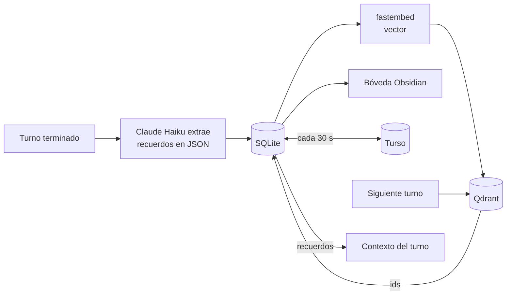

# Funcionamiento de Nova

Qué herramientas usa Nova, para qué usa cada una y cómo se pasan la información. La historia de
cómo se llegó a esto está en [desarrollo-de-nova.md](desarrollo-de-nova.md); los cambios por
versión, en [CHANGELOG.md](../CHANGELOG.md).

## Vista general

Nova tiene tres piezas que corren en la Mac y cuatro servicios externos:

| Pieza | Dónde vive | Qué hace |
|---|---|---|
| Servidor | `server.py` y `services/` (Python) | Escucha el micrófono, arma cada turno, habla con las APIs y guarda la memoria |
| Interfaz | `frontend/` (React) | Dibuja a Nova, reproduce su voz, maneja la cámara y muestra el cerebro y los gastos |
| Ventana de escritorio | `desktop/` (Electron) | Hace flotar la interfaz sobre el escritorio y la conecta con macOS |

| Servicio externo | Para qué | Qué recibe |
|---|---|---|
| Claude (Anthropic) | Pensar y responder, buscar en internet, extraer recuerdos, describir fotos | Texto del turno, contexto y, si se pide, una foto |
| ElevenLabs | Convertir cada frase en voz | Solo el texto que se va a decir |
| Turso | Copia en la nube de la memoria | La base SQLite, si está configurada |
| Modelos descargados una vez | Vosk, Whisper, embeddings, InsightFace, WeSpeaker, MediaPipe | Nada: corren dentro de la Mac |

```mermaid
flowchart LR
    Mic[Micrófono] --> Vosk[Vosk<br/>"Oye Nova"]
    Vosk --> Whisper[Whisper<br/>transcribe]
    Whisper --> Server
    UI[Interfaz React] <-->|WebSocket /ws| Server[Servidor aiohttp]
    Electron[Electron] -->|carga| UI
    UI <-->|IPC| Electron
    Server <--> Claude[Claude Haiku 5.5]
    Server --> Eleven[ElevenLabs]
    Server <--> SQLite[(SQLite)]
    SQLite <-->|cada 30 s| Turso[(Turso)]
    SQLite --> Qdrant[(Qdrant local)]
    SQLite --> Obsidian[Bóveda Obsidian]
    Server --> Mac[macOS<br/>captura y tecleo]
```

El servidor es el único que tiene las claves. La interfaz nunca habla con Claude ni con ElevenLabs:
todo pasa por el servidor, en `127.0.0.1:8787`.

## Herramientas y cómo se usan

### Servidor

| Herramienta | Dónde | Cómo se usa |
|---|---|---|
| aiohttp | `server.py` | Servidor web y WebSocket en `127.0.0.1:8787`. Solo acepta conexiones de su propio origen o de Vite (`localhost:5173`), para que otra página abierta no pueda usar las claves. También sirve la interfaz ya compilada a Electron |
| Pydantic | `services/schemas.py` | Cada mensaje que entra o sale, cada petición a una API y cada fila de la base es un modelo validado. Nada viaja como diccionario suelto |
| pydantic-settings | `config.py` | Lee y valida el `.env`. Si falta una clave, falla al arrancar sin imprimirla |
| SDK de Anthropic | `services/agents/llms_service.py` | Cliente de Claude con respuesta en streaming |
| sounddevice | `services/voice/listening_service.py` | Lee el micrófono a 16 kHz en bloques de 0.1 s |
| Vosk | `listening_service.py` | Escucha todo el tiempo, con una gramática cerrada, solo para detectar "Oye Nova" o "Nova" |
| pywhispercpp (Whisper) | `listening_service.py` | Transcribe lo que se dice después de llamarla. Usa `ggml-small.bin` si existe, si no `ggml-base.bin` |
| fastembed | `services/context/vector_index.py` | Convierte cada recuerdo en un vector con `paraphrase-multilingual-MiniLM-L12-v2`, dentro de la Mac |
| Qdrant (modo local) | `vector_index.py` | Busca recuerdos por significado. Solo guarda vectores e identificadores |
| SQLite con pyturso | `services/context/memory_store.py` | Fuente de la verdad: mensajes, ánimo, recuerdos, observaciones visuales y gastos |
| onnxruntime | `services/context/face_identity_service.py` | Corre los modelos de InsightFace (`det_500m` y `w600k_mbf`) para reconocer la cara de Carlos |
| sherpa-onnx | `services/context/voice_identity_service.py` | Corre WeSpeaker ResNet34 para saber si la voz de cada petición es la de Carlos. Se le enseña con "Nova, apréndete mi voz" y unas frases; el servidor junta unos 8 segundos sin pasar por Claude |
| Agente del navegador | `services/agents/browser_service.py` | Cuando le hablo desde la extensión de Chrome, Claude Sonnet 5.5 recorre páginas paso a paso con herramientas propias (leer, abrir, clic, escribir, desplazar). Cada acción la ejecuta la extensión |
| Gmail (SMTP) y mermaid-cli | `services/agents/report_service.py` | Reportes por correo: Claude Sonnet 5.5 investiga y escribe en Markdown, mermaid-cli dibuja los diagramas como PNG en la Mac y el correo sale por Gmail con una contraseña de aplicación. Solo llega a la dirección configurada |
| CED-tiny vía sherpa-onnx | `services/voice/sound_event_service.py` | Reconoce sonidos del cuarto cada segundo (golpes, vidrios, gritos, alarmas, ladridos, la puerta). Un sonido de alerta hace que Nova dé un vistazo |
| Vistazos por su cuenta | `services/context/surroundings_service.py` | Una foto cuando oye otra voz, un ruido raro o cada 20 minutos. Haiku la interpreta, decide si hablar, y lo que vio queda unas horas como contexto en memoria |
| Pillow y NumPy | Fotos y caras | Decodificar fotos, alinear caras y comparar huellas |
| ctypes | `services/desktop/mac_desktop.py` | Llama directo a CoreGraphics, Carbon y ApplicationServices para saber qué app está al frente, capturar su ventana y teclear |
| pygame-ce | `audio_manager.py` | Solo en la versión de consola, `nova_agm.py`, para reproducir la voz |

### Interfaz

| Herramienta | Dónde | Cómo se usa |
|---|---|---|
| React y TypeScript | `frontend/src/App.tsx` | Arma las vistas: Nova, el cerebro, los gastos y "Cómo te ve" |
| Canvas 2D | `frontend/src/nova/` | Dibuja a Nova en pixel art, pixel por pixel, con sus emociones, gestos y vuelo |
| Web Audio | `frontend/src/hooks/useNova.ts` | Decodifica y reproduce cada frase de voz en orden, y mide el volumen para mover la boca |
| MediaPipe Tasks Vision | `frontend/src/hooks/useCamera.ts` | Detecta cara y manos en el navegador para reconocer gestos. El video no sale de la Mac |
| three.js y d3-force-3d | `frontend/src/components/BrainView.tsx` | Muestra la memoria como neuronas en 3D que se encienden al recordar |
| Tailwind | `frontend/src/index.css` | Estilos |

### Ventana de escritorio

| Herramienta | Dónde | Cómo se usa |
|---|---|---|
| Electron | `desktop/main.cjs` | Abre una ventana transparente, sin marco y siempre encima, que carga `http://127.0.0.1:8787/?widget=1`. Pone el icono en la barra de menú y pide los permisos de micrófono y cámara a macOS |
| Puente de preload | `desktop/preload.cjs` | Expone `window.novaDesktop` a la interfaz: arrastrarla, moverla, mostrarla u ocultarla y avisar del estado del micrófono |

## Cómo se comunican

### Interfaz y servidor: un WebSocket

Todo viaja por un solo WebSocket en `/ws`. Los mensajes de texto son JSON con un campo `type`; la voz
viaja como mensajes binarios con el MP3 de cada frase.

| La interfaz manda | Para qué |
|---|---|
| `chat` | Un mensaje escrito, con si la cámara está encendida |
| `photo` | La foto que el servidor pidió, como data URL |
| `browser_result` | Lo que pasó en el navegador al ejecutar una acción: el texto de la página, un error o una captura |
| `auth` | Solo la extensión, como primer mensaje: su token de sesión |
| `gesture` | Un gesto de la mano detectado con MediaPipe |
| `interrupt` | Cortar a Nova mientras habla |
| `listen` / `mic_gate` | Encender el micrófono, y abrirlo o cerrarlo mientras Nova habla para que no se oiga a sí misma |
| `calm` | Borrar su estado de ánimo |
| `brain` / `usage` / `visual_profile` | Pedir los datos de cada vista |
| `forget_memory` / `forget_visual` / `forget_face` | Borrar un recuerdo, una observación o la huella de la cara |

| El servidor manda | Para qué |
|---|---|
| `token` | Texto de la respuesta, conforme llega |
| `emotion` | La mezcla de emociones que el personaje debe mostrar |
| Binario | El audio de cada frase, en orden |
| `photo_request` | Pide una foto a la interfaz |
| `search_start` / `search_done` | Muestra que está buscando y las fuentes |
| `write_start` / `write_done` | Muestra que está tecleando en otra app |
| `browser_action` | Pide a la extensión una acción en el navegador |
| `browse_start` / `browse_done` | Muestra que está usando el navegador y qué tarea hace |
| `move` | A dónde debe volar la ventana |
| `listen_state` / `heard` / `greeting` | Estado del micrófono, lo que entendió y el saludo al llamarla |
| `recall` / `brain` / `history` | Qué recuerdos se encendieron, el cerebro completo y el historial |
| `done` / `error` / `interrupted` | Fin del turno, error o interrupción |

Las peticiones que no son conversación, como pedir el cerebro, se atienden aunque haya un turno en
curso. Un segundo mensaje mientras Nova responde se rechaza con "Sigo respondiendo el turno anterior".
Si la interfaz se cierra a media respuesta, el turno se cancela para no seguir gastando en las APIs.

### Interfaz y Electron: IPC

La interfaz no toca macOS. Cuando el servidor manda `move`, la interfaz llama a
`window.novaDesktop.moveTo(lugar)` y Electron mueve la ventana. Al revés, Electron avisa a la
interfaz con `presence-command` cuando hay que aparecer u ocultarse, y con `microphone-command`
cuando se cambia el micrófono desde la barra de menú.

### Servidor y macOS

Para escribir en otra app, el servidor usa `mac_desktop.py`: identifica la app al frente, captura
solo su ventana y teclea letra por letra con eventos de CoreGraphics. Revisa antes que no haya un
campo de contraseña activo y se detiene si Carlos mueve el mouse o presiona Esc.

## Recorrido de un turno por voz

1. **Llamarla.** Vosk escucha el micrófono todo el tiempo. Solo reconoce un puñado de palabras
   parecidas a "Nova", para no activarse con cualquier ruido. Al oír "Oye Nova", el servidor avisa a
   la interfaz y Electron hace aparecer la ventana.
2. **Saludo.** Si no se dijo nada más, Nova saluda con una frase al azar. El audio de cada saludo
   se genera una vez con ElevenLabs y se guarda en `data/greetings/`, así que ya no cuesta.
3. **Transcribir.** Lo que se dice después se graba hasta un segundo de silencio, y Whisper lo
   transcribe en la Mac. Se descartan las frases que Whisper inventa con el silencio, como
   "gracias por ver". El audio nunca se guarda ni sale del equipo. Si ya conoce la voz de Carlos,
   WeSpeaker compara ese mismo audio con su huella, y Claude recibe la nota "es Carlos" o "no
   parece Carlos". Si no es él, el servidor ignora la petición: no se muestra ni llega a Claude.
   Una frase demasiado corta para saberlo vale si reconoció a Carlos en los últimos dos minutos.
4. **Preparar el contexto.** El orquestador, `services/agents/agm.py`, junta:
   - los últimos mensajes de la conversación, desde SQLite;
   - los recuerdos relacionados: Qdrant busca por significado y SQLite da el contenido;
   - cuánto tiempo pasó desde la última plática, cómo se siente Nova y si la han interrumpido;
   - si la cámara está encendida y lo que ha notado de cómo se ve Carlos.
5. **Elegir herramientas.** A Claude solo se le ofrecen las que tienen sentido en ese turno. Olvidar
   y moverse siempre. Buscar en internet, si está disponible. La cámara, solo si está encendida o se
   lo piden. Escribir en otra app y aprender la cara, solo si el mensaje lo pide con esas palabras.
6. **Responder en streaming.** Claude Haiku 5.5 responde sin razonamiento previo, para empezar a
   hablar pronto. Mientras llega el texto:
   - `EmotionTagFilter` separa las etiquetas de emoción, como `[[happy 0.6, curious 0.3]]`, y las
     manda como `emotion` antes que las palabras;
   - `NameFilter` quita "Carlos" cuando lo usa de muletilla;
   - `ChunkingService` corta el texto por oraciones completas, porque ElevenLabs entona mejor
     frases enteras;
   - `SpeechPipeline` pide a ElevenLabs hasta cuatro frases a la vez y entrega los audios en orden.
7. **Usar una herramienta.** Si Claude pidió buscar, mirar, escribir o aprender la cara, Nova dice
   una frase corta para no quedarse callada, se ejecuta la herramienta y Claude responde por segunda
   vez ya con el resultado. Solo se permite una herramienta de este tipo por turno.
8. **Seguir platicando.** Durante 20 segundos después de que termina de hablar, se le puede seguir
   hablando sin volver a decir "Nova". Mientras ella habla, la interfaz cierra el micrófono con
   `mic_gate`. Si Carlos se despide, Nova se oculta al terminar.
9. **Recordar.** Al cerrar el turno, la memoria trabaja aparte, sin retrasar la respuesta. Ver
   "Memoria" abajo.

Escribir en la interfaz sigue el mismo camino desde el paso 4, con un mensaje `chat` en lugar de la
voz.

## Las herramientas que Claude puede pedir

| Herramienta | Qué pasa cuando la pide |
|---|---|
| Buscar en internet | `WebSearchService` hace otra llamada a Claude con la herramienta `web_search` de Anthropic. El resumen y las fuentes vuelven al turno, y un extracto se guarda en el historial |
| Mirar | El servidor manda `photo_request`; la interfaz toma una sola foto y la regresa. `PhotoBudgetService` limita cuántas y cada cuánto. InsightFace revisa si Carlos está en la foto, y Claude la ve con esa nota. La foto no se guarda |
| Aprender la cara | Se toman tres fotos seguidas. Si en cada una hay una sola cara clara, el promedio de sus huellas se guarda en `data/face_profile.npy`, fuera de la base que se sube a la nube |
| Escribir en otra app | `DesktopWriter` captura la ventana al frente y se la da a un redactor aparte: otra llamada a Claude sin herramientas ni memoria. Lo que redacta se limpia en código para que nunca incluya un Enter, y se teclea. Nunca se envía nada |
| Mandar un reporte por correo | `ReportService` lo prepara en segundo plano y la plática sigue: Claude Sonnet 5.5 investiga y escribe, mermaid-cli dibuja los diagramas y Gmail lo envía. Al terminar, el servidor manda `email_done` y en el chat aparece "Te mandé el correo". Solo llega a Carlos |
| Usar el navegador | Solo desde la extensión de Chrome. `BrowserAgent` le da la tarea a Claude Sonnet 5.5, que pide acciones una por una; el servidor manda cada una como `browser_action` y espera `browser_result`. La extensión pide confirmación antes de comprar, enviar, publicar o borrar, y nunca escribe en contraseñas ni tarjetas. Al final, Nova cuenta lo que pasó |
| Moverse | El servidor manda `move` a todas las ventanas y Electron vuela a la esquina, se queda quieta, pasea, gira, baila o se oculta |
| Olvidar | `MemoryService` decide qué recuerdos corresponden al pedido, los borra de SQLite, Qdrant y Obsidian, y limpia el rastro en la nube. Nova confirma con lo que realmente se borró |

Algunas decisiones se toman en código y no en el modelo, porque una instrucción se puede ignorar y
el código no: si se le pide "mira", la foto se toma sin preguntar a Claude; las interrupciones se
cuentan y su efecto en el ánimo se calcula; el Enter se quita antes de teclear.

## Memoria



- **Guardar.** Después de cada turno, `MemoryService` manda la conversación a Claude Haiku con un
  esquema JSON fijo. Claude devuelve los recuerdos que valen la pena: hechos, gustos, personas,
  eventos, planes o momentos, con su importancia y las emociones de Nova en ese momento. Antes se le
  muestran los recuerdos parecidos que ya existen, para no duplicarlos.
- **Indexar.** Cada recuerdo nuevo se convierte en vector dentro de la Mac y entra a Qdrant. Qdrant
  y Obsidian se pueden borrar y reconstruir desde SQLite.
- **Recordar.** Al empezar un turno, Qdrant busca los recuerdos más cercanos a lo que se dijo,
  SQLite da su contenido y entran al contexto. La interfaz recibe `recall` y enciende esas neuronas.
- **Sincronizar.** Si hay `TURSO_DATABASE_URL` y `TURSO_AUTH_TOKEN`, la base se sincroniza con Turso
  cada 30 segundos y al apagar. Sin ellas, todo se queda en `data/nova.db`.
- **Leer.** La bóveda en `data/obsidian/` se regenera desde SQLite para leer la memoria con Obsidian.
  Es de solo lectura: lo que se edite a mano ahí se pierde.

La memoria visual funciona aparte. Cuando Carlos pide que lo mire, `VisualMemoryService` le pide a
Claude una observación con campos fijos y la guarda como datos, nunca como foto. Lo que no tiene
campo en el esquema no se puede guardar.

## Emociones

El modelo elige sus emociones con etiquetas dentro de la respuesta. `EmotionalStateService` las
mezcla con lo que Nova ya sentía y hace que se desvanezcan con el tiempo; ese estado se le describe
a Claude en cada turno. La interfaz recibe la mezcla y el dibujo cambia ojos, boca, color y
movimiento. Los gestos de la mano detectados por MediaPipe también provocan reacciones, con un
límite de una cada 30 segundos porque cada una gasta una llamada.

## Gastos

`UsageService` anota en SQLite los tokens de cada llamada a Claude, las búsquedas y los caracteres
enviados a ElevenLabs, junto con para qué fue cada uno: conversación, memoria, búsqueda o voz. La
vista de gastos lo pide con `usage` y además consulta a ElevenLabs cuánto queda del plan.

## Qué sale de la Mac y qué no

| Sale | No sale |
|---|---|
| El texto de cada turno y el contexto, hacia Claude | El audio del micrófono |
| Las fotos que se piden y los vistazos que Nova da por su cuenta, hacia Claude | El video de la cámara |
| El texto que Nova va a decir, hacia ElevenLabs | La huella de la cara |
| La base de memoria, hacia Turso, si está configurado | Los vectores de Qdrant |
| La captura de la ventana al frente, solo al pedirle que escriba | Las fotos: no se guardan en disco |

## Versión web

La misma Nova corre en Vercel con el mismo `NovaServer` y el mismo WebSocket. Cambia lo que la
rodea:

| Pieza | En la Mac | En la web |
|---|---|---|
| Servidor | aiohttp en `server.py` | FastAPI en `web/app.py` (rutas), con `web/settings.py`, `web/session.py` y `web/socket_adapter.py`, como función de Vercel |
| Acceso | Solo desde `localhost` | Contraseña (`NOVA_WEB_PASSWORD`) y una cookie firmada, `HttpOnly` y `SameSite=Strict` |
| Oír | Vosk y Whisper en la Mac | El dictado del navegador; en Chrome, el audio lo transcribe Google |
| Memoria | SQLite con copia en Turso cada 30 s | Copia en `/tmp`: la baja de Turso al conectarse y la sube al terminar cada turno |
| Buscar recuerdos por significado | fastembed y Qdrant | Apagado: usa solo el perfil |
| Escribir en otra app, moverse, caras, Obsidian | Sí | No |

`ServerFeatures` decide qué se enciende y `NovaServer` importa las librerías de la Mac solo si las
usa. Al conectarse, el servidor manda `capabilities` y la interfaz oculta lo que no aplica, como el
botón del micrófono del servidor.

Vercel corta cada conexión a los 300 segundos. La interfaz se reconecta sola en 1.5 segundos, y si
la sesión venció, el servidor cierra con el código 4401 y la página vuelve a pedir la contraseña.

La web y la Mac no deben usar la misma base de Turso al mismo tiempo: cada copia numera sus
mensajes por su cuenta, y al subirlos dos copias podrían pisarse. Por eso la web usa su propia
base hasta que eso se resuelva.

## Extensión de Chrome

La extensión es la misma interfaz de React, compilada como panel lateral de Chrome, conectada al
servidor de Vercel. Lo que la hace distinta es que puede usar el navegador.

| Pieza | Dónde | Qué hace |
|---|---|---|
| Manifest | `extension/manifest.json` | Pide los permisos `sidePanel`, `tabs` y `scripting`, y acceso a todas las páginas |
| Service worker | `frontend/src/extension/background.ts` | Abre el panel al tocar el icono de Nova y le presta el navegador a la Nova de la Mac por `127.0.0.1:8787/browser`, aunque el panel esté cerrado |
| Confirmación | `extension/confirm.html` | Ventanita que pregunta por un pago cuando la tarea viene de la Mac |
| Iconos | `extension/icons/` | La cabeza de Nova recortada de la hoja del personaje, en 16, 32, 48 y 128 px |
| Conexión | `frontend/src/nova/server.ts` | En la extensión, usa `https://nova-teal-two.vercel.app` y un token en lugar de la cookie |
| Acciones | `frontend/src/browser/actions.ts` | Ejecuta lo que pide el servidor con `chrome.tabs` y `chrome.scripting`, y decide qué necesita confirmación |
| Dentro de la página | `frontend/src/browser/page.ts` | Lee el texto visible, numera botones y campos, da clic y escribe como lo haría una persona |

Al entrar, el servidor devuelve la sesión firmada como token. La extensión lo guarda y lo manda como
primer mensaje del WebSocket; el servidor acepta el origen `chrome-extension://` solo así.

Nova es autónoma en el navegador: termina la tarea completa, incluido enviar mensajes y formularios. Lo único que la frena se decide en el código de la extensión, no en el modelo:

| Caso | Qué hace |
|---|---|
| Algo que cuesta dinero: comprar, pagar, suscribirse, transferir, donar | Pregunta "Nova quiere: … ¿Sigue?" y espera |
| Enviar un mensaje, publicar, borrar, llenar un formulario o buscar | Lo hace sin preguntar, si es parte de lo que le pediste |
| Enviar en un chat sin formulario (WhatsApp, Messenger) | Busca el botón de enviar junto al campo y le da clic; si no hay, simula Enter |
| Campo de contraseña o de tarjeta | Nunca escribe ahí |
| Páginas de Chrome (`chrome://`, la tienda de extensiones) | Chrome no deja entrar; se le avisa al modelo |

**Desde la Mac.** El service worker se conecta al servidor de la Mac en `/browser`. El servidor solo
acepta el origen `chrome-extension://gieebikbceifemmialncelfoblikepbp`, que es fijo porque el manifest
trae la llave pública de la extensión. Por esa conexión solo viajan `browser_action` y
`browser_result`. Si Chrome está conectado, la Nova de la Mac recibe la herramienta del navegador en
cada turno, por voz o escrito, y trabaja en la ventana de Chrome que esté al frente.

El agente nunca modifica su historial: Sonnet 5.5 firma su razonamiento con todo lo anterior, y
cambiar un mensaje viejo hace que la API responda 400. Las páginas viejas las borra el servidor de
Anthropic con la edición de contexto (`clear_tool_uses`), y así cada paso aprovecha el caché.

Límites: la cámara y el dictado pueden no pedir permiso desde el panel lateral, y Vercel corta la
conexión a los 5 minutos, así que una tarea en el navegador termina a los 200 segundos.

## Cómo arrancarla

| Modo | Comando | Qué levanta |
|---|---|---|
| Web en local, para probar | `uvicorn web.app:app --port 8788` con `NOVA_WEB_PASSWORD` y `NOVA_SESSION_SECRET` | La versión web con su contraseña, sirviendo `frontend/dist` |
| Web en Vercel | `npx vercel deploy --prod` | Compila la interfaz y despliega `web/app.py` (ver `pyproject.toml` y `vercel.json`) |
| Desarrollo en el navegador | `./start.sh` | El servidor y Vite; se abre `http://localhost:5173` |
| Extensión de Chrome | `npm --prefix frontend run build:extension` y cargar `extension/dist` en `chrome://extensions` | El panel lateral conectado a Vercel |
| App de escritorio | `.venv/bin/python server.py` y luego `npm --prefix desktop start` | El servidor sirve `frontend/dist` y Electron lo carga. Antes hay que compilar con `npm --prefix frontend run build` |
| Consola | `.venv/bin/python nova_agm.py` | Solo texto por teclado y voz por los altavoces, sin interfaz |

La ventana de Electron no se reconecta sola: si el servidor se cae, hay que levantarlo y volver a
abrir la ventana.
